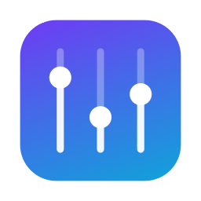
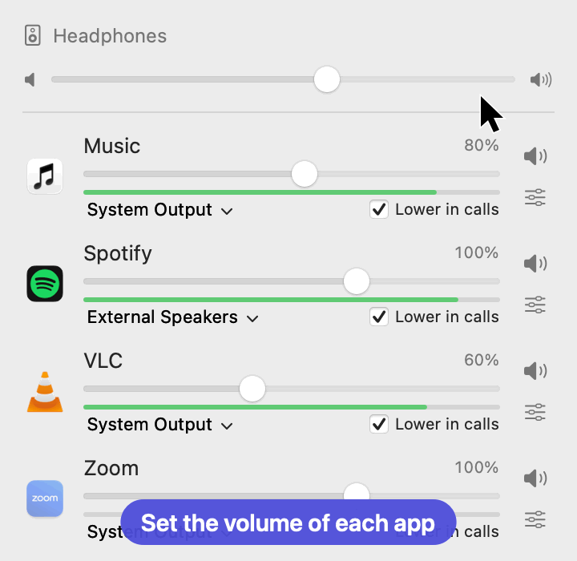
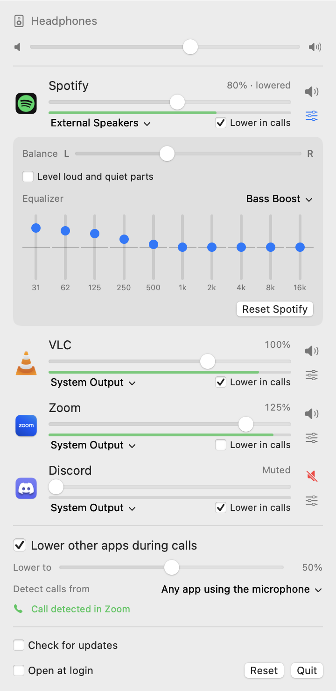

<p align="center">
  
</p>

<h1 align="center">Volumist</h1>

<p align="center">
  <strong>A free, open-source per-app volume mixer for macOS.</strong><br>
  Set the volume of each app and send it to its own output, right from the menu bar.
</p>

<p align="center">
  <a href="https://github.com/jpdominguez/volumist/releases/latest">Download</a> ·
  <a href="#install">Install</a> ·
  <a href="#faq">FAQ</a> ·
  <a href="docs/ARCHITECTURE.md">How it works</a>
</p>

<p align="center">
  <a href="https://alternativeto.net/software/volumist/about/?utm_source=badge&utm_medium=referral">
    
  </a>
</p>

<p align="center">
  
  <br><sub>The real interface, animated with sample data.</sub>
</p>

macOS has one volume slider for everything. Windows has had a volume mixer for years. Volumist brings the same
idea to the Mac: turn the music down without touching your call, mute a noisy app, or play Spotify on
your speakers while Zoom stays in your headphones.

## Features

- **Per-app volume**, from 0% to 150%, with a soft limiter above 100% to avoid harsh clipping.
- **Per-app mute** with one click.
- **Per-app leveling**: evens out loud and quiet parts, so ads and explosions stop making you jump.
- **Per-app equalizer**: 10 bands from 31 Hz to 16 kHz, with presets such as Bass Boost and Voice.
- **Per-app balance** between left and right.
- **Level meters** that show what each app is playing.
- **System volume slider**, so everything is in one place.
- **Per-app output routing**: send each app to a different speaker, monitor or pair of headphones.
- **Automatic lowering during calls**: music fades down when a call starts and back up when it ends. Choose how far
  it goes, what counts as a call, and which apps are left alone. Off by default.
- **Automatic fallback**: if a chosen output disconnects, the app moves to the system output and returns when the
  device comes back.
- **Remembers your settings** for each app.
- **Groups helper processes**, so a browser appears as one row rather than one per process.
- **No audio driver, kernel extension or virtual device.** Volumist uses Apple's Core Audio process taps.
- **Stays out of the way**: apps with default settings don't pass through Volumist at all.
- **Private**: no analytics, and audio is never recorded or stored. The only network request is the optional update
  check, which is off by default.
- **Tiny**: a native Swift and C app of about 3 MB, with no dependencies.

## Requirements

- macOS 14.2 (Sonoma) or later. Process taps do not exist on earlier versions.
- Apple silicon or Intel (universal binary).

Volumist has been tested on macOS 27.2 on Apple silicon. Reports from other macOS versions and from Intel Macs are
very welcome.

## Install

1. Download `Volumist-x.y.z.zip` from the [latest release](https://github.com/jpdominguez/volumist/releases/latest).
2. Unzip it and move `Volumist.app` to `/Applications`.
3. Open it. macOS will block the first launch because the app is not notarized by Apple. Go to
   **System Settings → Privacy & Security** and click **Open Anyway**. Alternatively, run:

   ```bash
   xattr -dr com.apple.quarantine /Applications/Volumist.app
   ```

4. Allow **audio capture** when macOS asks. Volumist needs this permission to process the audio of other apps.
5. Look for the sliders icon in the menu bar.

### Build from source

You only need the Xcode Command Line Tools.

```bash
git clone https://github.com/jpdominguez/volumist.git
cd volumist
./scripts/build.sh
open build/Volumist.app
```

## Usage

Click the menu bar icon to see the apps that are playing audio, plus any app you have already adjusted.

<p align="center">
  
</p>

| Control | What it does |
| --- | --- |
| Slider | Sets the app's volume. It snaps to 100% so you can easily return to normal. |
| Level meter | Shows the app's level while the window is open. |
| Speaker button | Mutes or unmutes the app. |
| Sliders button | Opens the app's balance, leveling and equalizer. |
| Output menu | Picks the device for this app, or **System Output** to follow macOS. |
| Top slider | Sets the Mac's volume, the same as the keyboard keys. It is hidden for outputs with no volume control. |
| Lower other apps during calls | Turns automatic lowering on or off. |
| Lower to | How far apps go down during a call, relative to their own volume. |
| Detect calls from | **Any app using the microphone**, or **Known call apps only**. |
| Lower in calls | Per-app checkbox, to leave an app out of automatic lowering. |
| Check for updates | Looks for a new release at launch and once a day, and shows a link if there is one. |
| Reset *App* | In the app's details, returns that app to its defaults. |
| Reset | Returns every app to its defaults. |
| Open at login | Starts Volumist when you log in. |

To close the window, click anywhere else or press Escape. Quitting Volumist returns every app to normal audio.

## Limitations

- An app that plays to a specific device of its own choosing is sent to the output selected in Volumist once you
  adjust it.
- When an adjusted app starts playing there can be a fraction of a second of silence. This is deliberate: the
  alternative is a burst at full volume.
- Volumes are per app, not per browser tab.
- Balance has no effect on mono outputs, such as Bluetooth headphones while their microphone is in use.
- The 16 kHz equalizer band is skipped on outputs with a low sample rate, such as that same Bluetooth mode.
- Calls are detected from microphone use, so a muted call still counts, and so does dictating or recording in another
  app unless you switch to **Known call apps only**. A call in listen-only mode isn't detected.
- Bluetooth headphones switch to a lower-quality mode whenever an app uses their microphone. That is a macOS
  behavior and it applies to the audio Volumist plays too.
- Volumist uses two private system functions (see [the architecture notes](docs/ARCHITECTURE.md#private-apis)), so
  it cannot be distributed through the Mac App Store as it stands.

## FAQ

### How do I change the volume of individual apps on a Mac?

macOS has no built-in way to do this. Install Volumist, click its menu bar icon and move the slider next to the
app.

### Is there a volume mixer for Mac like the one in Windows?

Not built in, but Volumist works the same way: one slider per app, in the menu bar.

### Can I play different apps through different speakers on a Mac?

Yes. Use the output menu under each app in Volumist.

### How do I lower Spotify or music without lowering my Zoom or Teams call?

Lower the slider for the music app and leave the call app at 100%.

### Can my Mac lower the music automatically when a call starts?

Yes. Turn on **Lower other apps during calls** in Volumist. It detects calls from microphone use, fades down the
other apps that are playing, and restores them when the call ends. The app in the call is never lowered.

For browser calls such as Google Meet, keep **Any app using the microphone** selected: browsers are not in the list
of known call apps, because they use the microphone for many other things.

### How do I stop ads or videos being louder than everything else on a Mac?

Open the app's details in Volumist and turn on **Level loud and quiet parts**. It lowers loud passages quickly, by up
to 12 dB, and raises quiet ones slowly, by up to 9 dB.

### Can I use a different equalizer for each app on a Mac?

Yes. Click the sliders button next to an app in Volumist to open its 10-band equalizer.

### Does Volumist record my audio?

No. macOS labels the permission "audio capture" because Volumist has to read an app's audio in order to change its
volume. The audio is processed in memory, in real time, and goes straight to the output device. Volumist never
writes it to disk or sends it anywhere, and you can verify that in the source code.

### Does Volumist connect to the internet?

Only if you turn on **Check for updates**. It then asks GitHub for the latest release, and sends no data about you or
your Mac beyond what any web request does. Updates are never installed automatically.

### Why does macOS say the app can't be verified?

Releases are not signed with a paid Apple Developer ID. See step 3 of [Install](#install), or build it yourself.

### An app went silent. What should I do?

Click **Reset** in Volumist, or quit Volumist: its audio processing ends and the app returns to normal. If the issue
persists, check that Volumist is enabled under **System Settings → Privacy & Security → Screen & System Audio
Recording**, and please [open an issue](https://github.com/jpdominguez/volumist/issues).

### How do I uninstall it?

Quit Volumist and move it to the Trash. To also remove its settings, run:

```bash
defaults delete io.github.jpdominguez.volumist
```

## Alternatives

If Volumist doesn't fit your needs, you may prefer [FineTune](https://github.com/ronitsingh10/FineTune),
[Background Music](https://github.com/kyleneideck/BackgroundMusic), or the commercial
[SoundSource](https://rogueamoeba.com/soundsource/).

## Contributing

Bug reports, testing on other Macs and pull requests are welcome. See [CONTRIBUTING.md](CONTRIBUTING.md).

## License

[MIT](LICENSE) © Juan Pedro Dominguez-Morales
